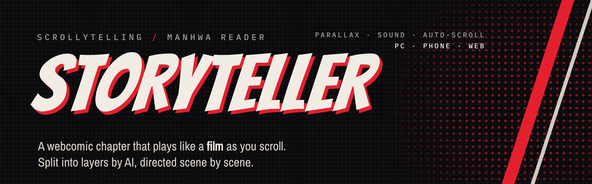
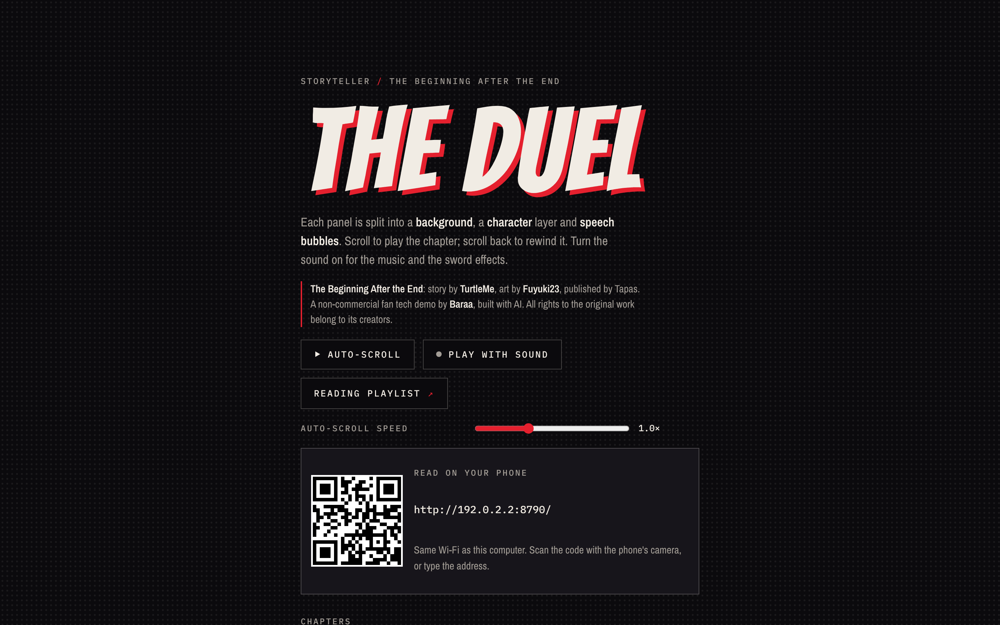
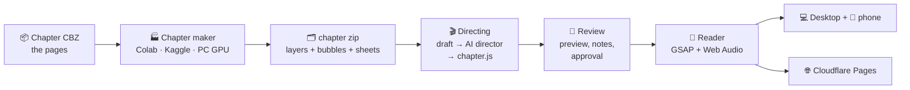

<p align="center">
  
</p>

<p align="center">
  <a href="https://tbate-scroll-demo.pages.dev"><b>▶ Watch the live demo</b></a> ·
  <a href="#-install-the-desktop-reader-windows">Install the desktop reader</a> ·
  <a href="#-how-it-works">How it works</a> ·
  <a href="#-make-a-new-chapter">Make a chapter</a>
</p>

<p align="center">
  
  
  
  
  
</p>

---

**Storyteller** turns a manhwa chapter into a **scroll-driven short film**. Every panel is split by AI into a background, a
character layer and its speech bubbles. Then each scene is directed by hand: camera moves, 2.5D parallax, zoom-through
cuts, particles, impact flashes, sword sounds and music that follows the story. Scroll forward and the chapter plays.
Scroll back and it rewinds.

It is a non-commercial fan project built on *The Beginning After the End* (story by **TurtleMe**, art by **Fuyuki23**,
published by Tapas). See [Credits and copyright](#-credits-and-copyright).

<p align="center">
  
  <br><sub>The desktop reader's first screen, with the QR code that opens the same reader on your phone.</sub>
</p>

> 📘 **Every detail** (each script step by step, the AI models, the frontend engine, music, sound, builds): see
> [`docs/HOW_IT_WORKS.md`](docs/HOW_IT_WORKS.md).

## Contents

- [Features](#-features)
- [Install the desktop reader (Windows)](#-install-the-desktop-reader-windows)
- [Read on your phone](#-read-on-your-phone)
- [Add new chapters](#-add-new-chapters)
- [Mac and Linux](#-mac-and-linux)
- [Troubleshooting](#-troubleshooting)
- [How it works](#-how-it-works)
- [Make a new chapter](#-make-a-new-chapter)
- [Direct a chapter](#-direct-a-chapter)
- [Build and share](#-build-and-share)
- [Project layout](#-project-layout)
- [Tech stack](#-tech-stack)
- [Status and roadmap](#-status-and-roadmap)
- [Credits and copyright](#-credits-and-copyright)

---

## ✨ Features

| | |
|---|---|
| 🎬 **Scroll-scrubbed scenes** | One long GSAP timeline per chapter. Push-ins, pans down tall panels, sideways drifts, zoom-through transitions into the big moments. Scrolling back rewinds everything exactly. |
| 🧅 **2.5D parallax** | Characters and backgrounds move separately, so each panel gets depth. The layers come from AI cutouts (two BiRefNet models, refined with ViTMatte) and an AI-filled background (LaMa). |
| 💬 **Living speech bubbles** | Bubbles pop in once you can see who is speaking, in reading order, and fade before the next beat. They are kept on screen and never cut off. |
| ✨ **Particles and impacts** | Embers in each fighter's mana colour, wind, speed lines and dust. Sparks, rings, flares and breaking glass on hits, with screen shakes and flashes up to a full white-out. |
| 🔊 **Sound design** | 13 sound effects made in the browser (whoosh, crack, flame, shatter, crash, gust…) plus two recorded sword sounds. Music themes (calm, tension, battle, climax) crossfade between story stretches, and the music dips under every effect so hits always land. |
| ▶ **Auto-scroll** | Hands-free reading with a 0.5×–2× speed slider. It slows for each bubble (longer for more words) and lingers after big hits. A touch, wheel or key pauses it. |
| 📱 **PC and phone** | The desktop reader serves the chapters to your browser and to any phone on the same Wi-Fi, with a QR code on screen. Nothing to install on the phone. |
| 🌐 **Web ready** | One command builds a website zip for Cloudflare Pages: a private link for friends, or a public demo with link-preview tags. |
| ⚡ **Light on a phone** | Only the panels near you are kept in memory, pictures are unpacked just before they are needed, and everything the reader needs comes from one server. If a device still struggles, the particles thin out by themselves. |
| ♿ **Reduced motion** | Readers who turn on "reduce motion" get the panels as a calm, plain column. |

---

## 💻 Install the desktop reader (Windows)

The desktop reader is a small program that shows the chapters in your browser and shares them with your phone over Wi-Fi.
It needs **Python** (free) and nothing else: once the chapters are on your computer, it works without the internet.

### Step 1: Install Python (once)

1. Open <https://www.python.org/downloads/release/python-3128/>.
2. Scroll down to **Files** and click **Windows installer (64-bit)**.
3. Run the installer. At the bottom of the first screen, **tick "Add python.exe to PATH"**, then click **Install Now**.

> Any Python from 3.8 up works. If you already installed Python for the chapter-making kit, skip this step.

### Step 2: Get the reader

Pick **one** of these:

<table>
<tr>
<th width="50%">A. The ready-made zip (easiest)</th>
<th width="50%">B. Straight from GitHub</th>
</tr>
<tr>
<td valign="top">

If you received **`Storyteller-Reader.zip`**, it already holds the chapters.

1. Right-click the zip → **Extract All…**
2. Choose a folder, for example<br>`D:\Work\StoryTelling website\Storyteller Reader`
3. Click **Extract**.

</td>
<td valign="top">

1. On this page, click the green **Code** button → **Download ZIP**.
2. Right-click the downloaded zip → **Extract All…** → **Extract**.
3. Open the extracted folder, then **`tools`** → **`reader`**.

This version has no chapter pictures yet (they are not stored on GitHub).
Add them with a reader pack: see [Add new chapters](#-add-new-chapters).

</td>
</tr>
</table>

### Step 3: Start it

1. Double-click **`Read Storyteller`**.
   If Windows shows "Windows protected your PC", click **More info** → **Run anyway**.
2. A black window opens, and the reader opens in your browser at `http://localhost:8000/`.
3. **The first time only**, Windows asks whether Python may use the network. Tick **Private networks** and click
   **Allow access**. This is what lets your phone in.
4. Keep the black window open while you read. **Closing it stops the reader.**

### Step 4: Read

- Pick a chapter from the **Chapters** list on the first screen.
- Click **Play with sound** for music and effects. Browsers keep pages silent until you click.
- Click **Auto-scroll** to read hands-free, and drag the **speed** slider to taste. Your speed is remembered.
- Scroll with the mouse wheel, the arrow keys or the space bar. Scrolling back rewinds the scene.

---

## 📱 Read on your phone

1. Make sure the phone is on the **same Wi-Fi** as the computer (not on mobile data).
2. Start the reader on the computer.
3. Scan the **QR code** on the reader's first screen with the phone's camera. Or type the address that the black window shows after
   **On your phone**, for example `http://192.168.1.23:8000/`.
4. Tip: in the phone's browser, **Share → Add to Home Screen** gives the reader its own app icon.

---

## ➕ Add new chapters

New chapters arrive as **reader packs**: zips named `reader-pack_<chapter>.zip`.

1. Put the zip in the **`new chapters`** folder next to `Read Storyteller`.
   (In the GitHub download that is `tools\reader\new chapters`. The folder appears after the first start.)
2. Double-click **`Read Storyteller`**. The pack is added by itself, the zip moves to `new chapters\added`, and the chapter
   menu updates.

Reader updates (`reader-update.zip`) go in the same folder and are added the same way.
Chapter zips from the chapter maker (`chapter_<number>.zip`) are **not** reader packs: they still have to be directed first
(see [Direct a chapter](#-direct-a-chapter)).

---

## 🍎 Mac and Linux

The reader only uses what comes with Python 3.8+, so it runs anywhere:

```bash
python3 tools/reader/reader.py
```

Options: `--port 8000` picks the port (it moves to the next free one, up to 8010), and `--no-browser` stops it from opening a
browser tab.

To look at the site with no reader at all:

```bash
cd site
```

```bash
python3 -m http.server 8000
```

Then open <http://localhost:8000/>. Opening `index.html` by double-clicking it shows the panels, but the browser blocks the
music and chapter loading.

---

## 🧰 Troubleshooting

| Problem | Fix |
|---|---|
| The black window says **Python is not installed yet** | Do [Step 1](#step-1-install-python-once) and make sure **Add python.exe to PATH** was ticked. Reinstalling with the box ticked fixes it. |
| **"Windows protected your PC"** | Click **More info** → **Run anyway**. It's a normal warning for files from the internet. |
| The phone can't open the address | Same Wi-Fi on both? Then: Windows **Settings → Network & internet → Wi-Fi** (or Ethernet) → your network → **Network profile type: Private**. If you clicked Cancel on the firewall question: **Windows Security → Firewall & network protection → Allow an app through firewall → Change settings** → tick **Private** next to Python. |
| **"Chapter not ready"** | That chapter's `chapter.js` is missing. Add the chapter's reader pack again. |
| Panels are empty or black | The chapter's pictures are missing (the GitHub download has none). The black window lists them under **No pictures yet for**. Add the reader pack. |
| No sound | Click **Play with sound** (or **Sound off** at the top). Check the computer's volume. |
| A new version doesn't show | Press **Ctrl + F5** in the browser to reload without the cache. |
| **Ports 8000-8010 are all in use** | Close other copies of the reader (other black windows), then start it again. |

---

## 🧠 How it works



1. **The chapter maker** joins a chapter's pages into one long strip and runs the **layer splitter** on it:
   - **Panels**: rows of the gutter colour separate the panels. Very tall stretches of plain space are dropped, and very tall
     pictures are cut at their calmest row, so the AI never has to squash a panel.
   - **Speech bubbles**: near-white shapes with black lettering inside, told apart from eyes and white faces by the
     shape and colour of their letters.
   - **Characters**: two BiRefNet models (`birefnet-general` + `birefnet-hrsod`), each run on the panel and on a mirrored
     copy and then combined. ViTMatte refines hair and flames, and edge colours are cleaned so there is no fringe.
   - **Background**: LaMa paints in what the characters and bubbles covered.
   - Series title pages and promo pages are recognised by fingerprint and dropped. Everything is saved as WebP (about
     10–15 MB per chapter), with overview sheets for checking by eye.
2. **Directing**: `draft_chapter.py` writes a first scene plan from the zip, and an AI director in a Claude Code session
   shapes it into the final `chapter.js`, scene by scene, following a house style (camera, transitions, impacts,
   particles, bubbles, music, quiet beats). Every chapter is reviewed and approved before it goes into the reader.
3. **The reader** (`site/index.html`) builds one pinned stage and one scroll-scrubbed timeline (1 unit = 1% of the
   screen height) from the plan. Images load only near the reader, and particle canvases exist only on screen.

---

## 🏭 Make a new chapter

The chapter maker needs a graphics card. There are three ways to run it, all making the same `chapter_<id>.zip`:

| Where | How | Good for |
|---|---|---|
| **Google Colab** | Upload `tools/make-chapter/Make_Chapter.ipynb`, choose a **T4 GPU** + **High-RAM**, set `CHAPTERS`, **Runtime → Run all**, allow Drive. CBZ files come from Drive `Storyteller/cbz`, and zips go to `Storyteller/chapters`. | A few chapters. The tab must stay open. |
| **Kaggle** | Import `tools/make-chapter/Make_Chapters_Kaggle.ipynb`, add the CBZ dataset as **Input**, choose **GPU T4 ×2**, switch **Internet** on, then **Save Version → Save & Run All**. | Big batches: two chapters at once, runs with the browser closed, ~30 free GPU hours a week. Add the previous run's Output as Input to continue where it stopped. |
| **Your PC (NVIDIA GPU)** | Unzip the PC kit (`python tools/build_notebooks.py` writes `dist/Storyteller-PC-Tools.zip`), double-click **`Setup`** once (10–20 min, ~8 GB, Python 3.12), then **`Make Chapters`**. | No time limits, overnight runs. Finished zips land in `finished\`. |

From the command line (any of the above runs this):

```bash
python tools/make-chapter/make_chapter.py --cbz-dir cbz --out chapters --chapters 1-5,94
```

Useful flags: `--redo` (make again), `--skip '{"94":[0,69]}'` (drop pages by hand), `--shard 1/2` (split a batch between
two GPUs), `--done-dir DIR` (skip chapters finished in an earlier run), `--max-hours 11`.

Speed: about **10 seconds per panel** on a T4, or **13–23 minutes per chapter**. Both cutout models always run, for accuracy.

<details>
<summary><b>What's in a chapter zip</b></summary>

| File | What |
|---|---|
| `panel_XX_background.webp`, `panel_XX_characters.webp` | the two layers of each panel |
| `bubble_XX.webp` | each speech bubble |
| `chapter.json` | panels (position, size, `tiny`, `continues`), bubbles (panel, position, `suspect`), dropped pages, timings |
| `sheets/pages.jpg` | every page, dropped ones crossed out |
| `sheets/panels_XX-YY.jpg` | the original panels, five per sheet |
| `sheets/bubbles.jpg` | every bubble with its panel |

More: [`tools/make-chapter/README.md`](tools/make-chapter/README.md) and
[`tools/layer-splitter/README.md`](tools/layer-splitter/README.md).
</details>

After changing `split_layers.py`, `make_chapter.py` or `gpu_check.py`, run `python tools/build_notebooks.py` to rebuild
the notebooks and the PC kit.

---

## 🎬 Direct a chapter

```bash
python tools/director/draft_chapter.py chapter_094.zip --out site/chapters/094/chapter.js --title "The Duel"
```

The draft covers every panel with a gentle camera move, dust, bubbles in reading order and one music stretch. Directing turns it
into a scene plan. This is the real one for panel 79 of chapter 94:

```js
// panel 79, TEMPEST: a zoom-through entry, a held green-white flash, shakes, wind and a gust
{ id: "panel_79", w: 940, h: 1538, length: 330, fit: "pan", enter: "zoom", exit: "fade",
  chars: { from: { scale: 1.06 }, to: { scale: 1 }, over: [0.05, 0.3] },
  shakes: [0.13, 0.3], flashes: [{ at: 0.12, color: "#d9ffee", strength: 0.85, hold: 0.04 }],
  sfx: [{ at: 0.12, sound: "gust" }, { at: 0.3, sound: "whoosh" }],
  fx: { ambient: "embers", tint: "wind", amount: 1.7,
    bursts: [{ type: "flare", tint: "wind", at: 0.13, from: [72, 30] }, { type: "ring", at: 0.14, from: [55, 80] }] } },
```

Every setting (`fit`, `camera`, `bg`/`chars` parallax, `bubbles`, `shakes`, `flashes`, `sfx`, `fx`, `enter`/`exit`) is
explained in [`site/README.md`](site/README.md). To add the chapter to the reader, put its images next to its `chapter.js` in
`site/chapters/<id>/` and add one line to `chapters` in [`site/series.js`](site/series.js).

`cut_chapter.py` cuts a short demo out of a directed chapter. That's how the 19-panel public demo was made:

```bash
python tools/director/cut_chapter.py site/chapters/094 --id 094-demo --title "The Duel" --panels 01,02,04,06,07,70-72,74-76,78,79,81,84,86,87,89,92 --music "tension:01,climax:70,calm:92"
```

---

## 📤 Build and share

All builds come from [`tools/reader/build_reader.py`](tools/reader/build_reader.py) and land in `dist/`. The chapter
images have to be in `site/chapters/<id>/` first.

| Command | Makes | For |
|---|---|---|
| `python tools/reader/build_reader.py` | `Storyteller-Reader.zip` | the desktop reader with every chapter in `series.js` |
| `python tools/reader/build_reader.py --pack 094` | `reader-pack_094.zip` | adding a chapter to an installed reader |
| `python tools/reader/build_reader.py --reader-update` | `reader-update.zip` | updating an installed reader's page |
| `python tools/reader/build_reader.py --site` | `Storyteller-Site.zip` | a private website (kept out of search engines) |
| `python tools/reader/build_reader.py --site --chapters 094-demo --public https://tbate-scroll-demo.pages.dev --cover site/chapters/094-demo/cover.jpg --out Storyteller-Demo.zip` | `Storyteller-Demo.zip` | the public demo, with link-preview tags |

**Publish on Cloudflare Pages:** **Workers & Pages → Create → Pages → Upload assets**, drag the website zip in, then
**Deploy**. For a new version: open the project → **⋯** → **Create deployment** → drag the zip → **Deploy**. Then press
**Ctrl + F5** on the site.

The demo video (56 s, 1080×1350, with music and effects) is recorded frame by frame with
[`tools/reader/record_demo.js`](tools/reader/record_demo.js), and its soundtrack is rendered with
[`render_demo_audio.js`](tools/reader/render_demo_audio.js).

---

## 📁 Project layout

```
site/                         the reader (details: site/README.md)
  index.html                  engine: stage, timeline, particles, sound, auto-scroll, chapter menu
  series.js                   title, credit, chapter list, music themes, mix, auto-scroll pauses, recorded sounds
  chapters/<id>/chapter.js    one chapter's scene plan (its .webp images are not in git)
  music/  sfx/                music loops by theme, recorded sword sounds
  vendor/                     the animation library (GSAP) and the fonts, served with the reader
tools/
  layer-splitter/             split_layers.py: panels, bubbles, AI cutouts, AI background fill
  make-chapter/               make_chapter.py + the Colab and Kaggle notebooks, gpu_check.py
  pc/                         the Windows chapter kit: Setup.bat, Make Chapters.bat
  director/                   draft_chapter.py (first drafts), cut_chapter.py (demo cuts)
  reader/                     the desktop reader (reader.py, Read Storyteller.bat), build_reader.py, demo video tools
  music/                      Make_Music.ipynb (new music themes on Colab), make_loop.py (seamless loops)
  voices/                     make_voices.py (voices are switched off for now)
  perf/                       speed and "nothing changed" checks for the reader, on a simulated phone
  build_notebooks.py          rebuilds the notebooks and the PC kit from the scripts
series/cast.md                the cast: looks, magic colours, first appearances
docs/images/                  the pictures in this README
HANDOFF.md                    the full project notes, for the next working session
```

---

## 🔧 Tech stack

| Part | Built with |
|---|---|
| Reader | HTML, CSS and plain JavaScript · [GSAP 3.12.5](https://gsap.com) + ScrollTrigger · Canvas 2D particles · Web Audio (synthesised effects, limiter, soft clip, music ducking) |
| Desktop reader | Python standard library (`http.server`): no installs beyond Python · QR code by `qrcode-generator` |
| AI layer splitting | [rembg](https://github.com/danielgatis/rembg) with BiRefNet (general + HRSOD) · ViTMatte · pymatting · [LaMa](https://github.com/advimman/lama) inpainting · OpenCV, NumPy, SciPy · ONNX Runtime (CUDA / DirectML / CPU) · PyTorch |
| Compute | Google Colab (T4) · Kaggle (2× T4) · a local NVIDIA RTX GPU |
| Music | MusicGen (on Colab) · seamless loops cut with NumPy + ffmpeg |
| Hosting | Cloudflare Pages (static upload) |
| Directing | an AI director working in [Claude Code](https://claude.com/claude-code) sessions, with the user approving every chapter |
| Look | ink black `#0b0a0d`, paper white `#f1ece4`, one flat red `#e5202e`, halftone dots · Bangers, Archivo Narrow, IBM Plex Mono |

---

## 🧭 Status and roadmap

- [x] Chapter 94, **"The Duel"**: 90 scenes, fully directed and approved
- [x] Public 19-panel demo and a 56-second demo video
- [x] Desktop reader for PC and phone, website builds for Cloudflare Pages
- [x] Chapter maker on Colab, Kaggle and a Windows PC
- [x] Auto-scroll with a speed slider, sound rebalance with ducking
- [ ] Chapters from Episode 1 onwards (chapters 1–30 being processed on Kaggle)
- [ ] More music themes: sad, eerie, triumph
- [ ] The director playbook as a reusable skill
- [ ] A lighter directing mode for dialogue chapters, then voices

---

## 📜 Credits and copyright

**The Beginning After the End**: story by **TurtleMe**, art by **Fuyuki23**, published by **Tapas**. All rights to the
original work belong to its creators.

Storyteller is a **non-commercial fan tech demo** by **Baraa**, built with AI. The chapter images are **not** stored in
this repository. The full chapter is shared privately with friends only, and the public demo is a short excerpt with
credits. Please support the official release.

The code in this repository is the project author's. No open-source license is granted unless one is added.
